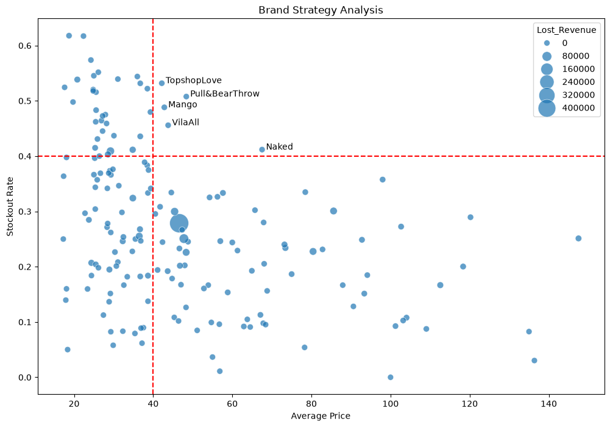

# ASOS Product Availability and Brand Analysis

This project explores product availability and brand level stockout indicators using an ASOS product catalogue. The analysis is in a Jupyter notebook and uses pandas, NumPy, Matplotlib, and Seaborn.



## Project files

| File | Description |
| --- | --- |
| `product.ipynb` | Notebook containing data cleaning, analysis, and visualization |
| `products_asos.csv` | Product catalogue used by the notebook |
| `assets/image.png` | Brand strategy scatter plot shown above |

## Requirements

- Python 3
- Jupyter Notebook or JupyterLab
- pandas, NumPy, Matplotlib, and Seaborn

Install the dependencies:

```bash
python -m pip install pandas numpy matplotlib seaborn jupyter
```

## Run the notebook

1. Keep `products_asos.csv` beside `product.ipynb`.
2. Open `product.ipynb` in Jupyter Notebook or JupyterLab.
3. In the CSV-loading cell, use a relative path:

   ```python
   df = pd.read_csv("products_asos.csv", on_bad_lines="skip")
   ```

   The notebook currently contains an absolute path from its original Windows environment; change it as shown above when running the project elsewhere.
4. Run the notebook cells from top to bottom.

The notebook includes a `%pip install datasets` cell, although the analysis does not use the `datasets` package.

## Analysis

The notebook cleans product prices, extracts brand names from descriptions, and keeps brands with more than five products. It counts unavailable sizes, estimates product level lost revenue, prints the top five estimates, and compares brand average price with average stockout rate. The scatter plot includes brands with more than ten products; bubble size represents summed estimated lost revenue. Dashed reference lines mark an average price of 40 and a stockout rate of 0.4.

## Metrics and limitations

- **Stockout count:** occurrences of `Out of stock` in the product's size string.
- **Stockout rate:** stockout count divided by the number of comma-separated entries in the size string.
- **Estimated lost revenue:** listed product price multiplied by stockout count; brand totals sum these product estimates.

These are exploratory estimates based on catalogue text, not observed sales or a revenue forecast. The calculation assumes each unavailable size corresponds to one unrealized sale at the listed price. It does not account for demand, quantities sold, timing, or currency. It also assumes consistent comma-separated size entries, and the simple brand extraction may misclassify descriptions with different wording.
